# Game Boy DX Colorizations

This project brings full color to classic Game Boy games on the Game Boy Color. Each DX colorization is distributed as an IPS patch. The patched games retain their original appearance on the original Game Boy and Super Game Boy.

## Latest patches

| Game | Version | IPS patch |
| --- | --- | --- |
| Teenage Mutant Ninja Turtles: Fall of the Foot Clan | v30 | [tmntdx_v30.ips](patches/tmntdx_v30.ips) |
| Teenage Mutant Ninja Turtles II: Back from the Sewers | v12 | [tmnt2dx_v12.ips](patches/tmnt2dx_v12.ips) |
| Teenage Mutant Ninja Turtles III: Radical Rescue | v6 | [tmnt3dx_v6.ips](patches/tmnt3dx_v6.ips) |
| Mighty Morphin Power Rangers | v5 | [mmprdx_v5.ips](patches/mmprdx_v5.ips) |

## Gameplay screenshots

### TMNT: Fall of the Foot Clan

### TMNT II: Back from the Sewers

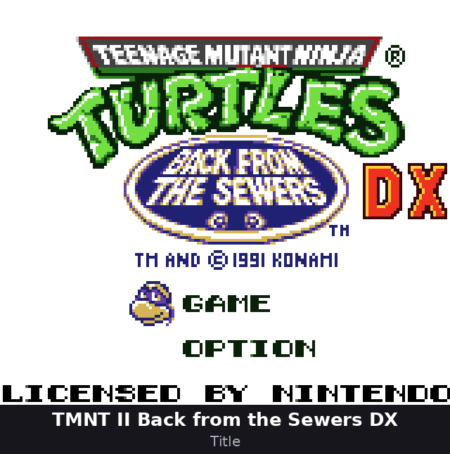
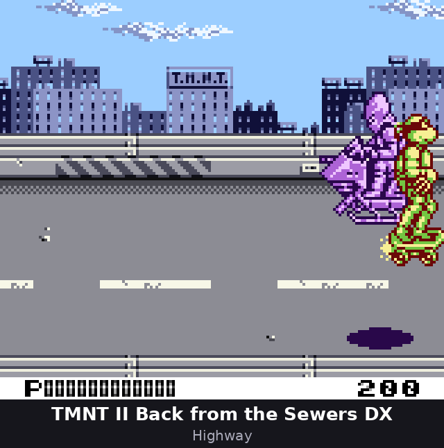
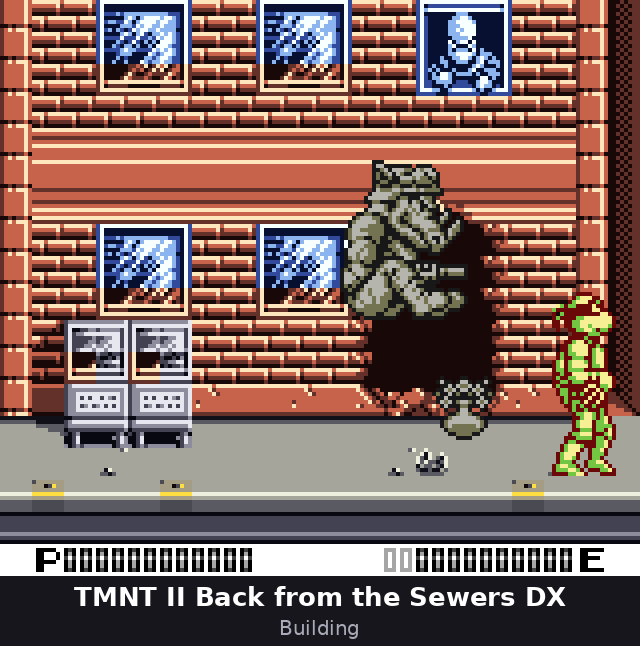
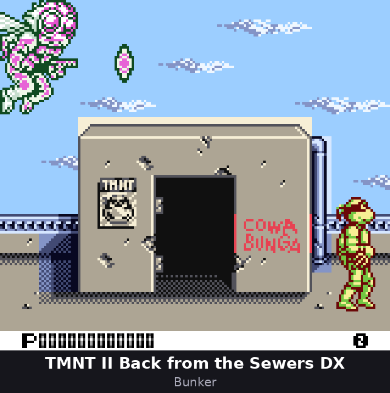
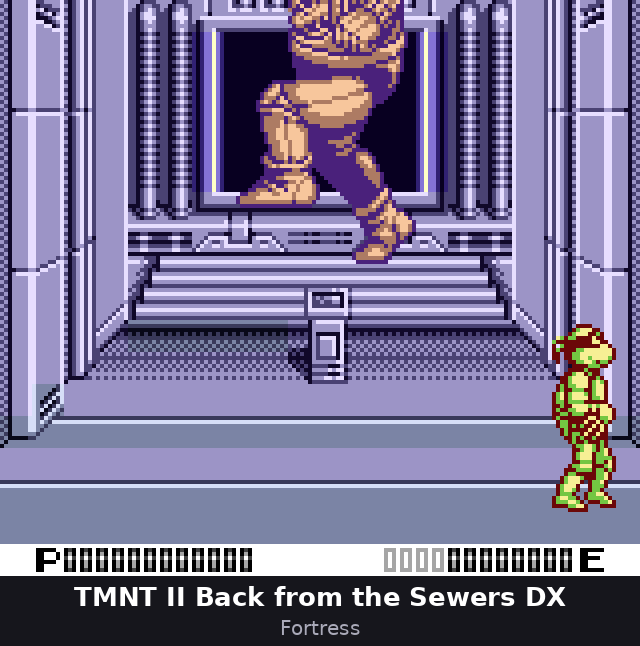

### TMNT III: Radical Rescue

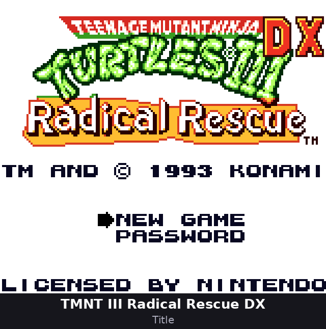
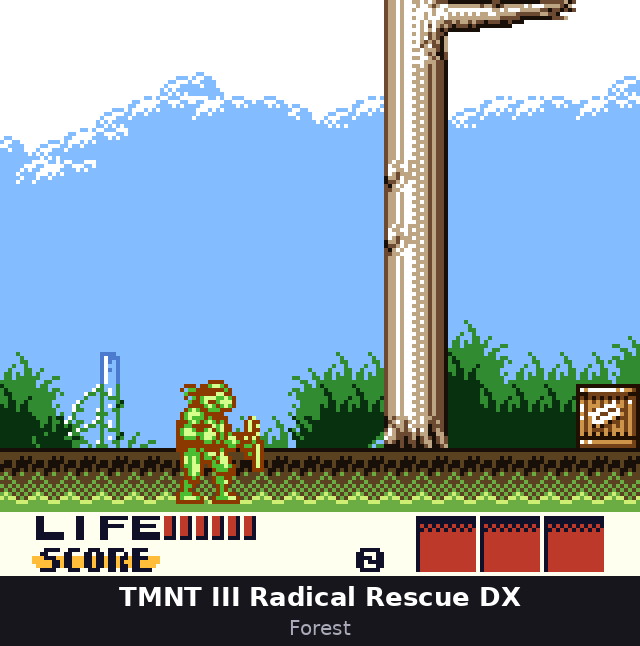
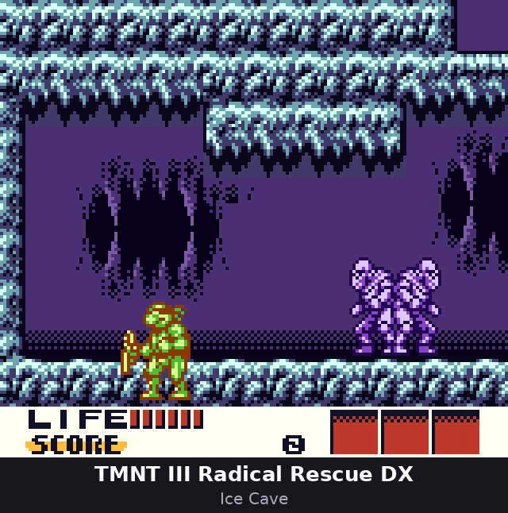
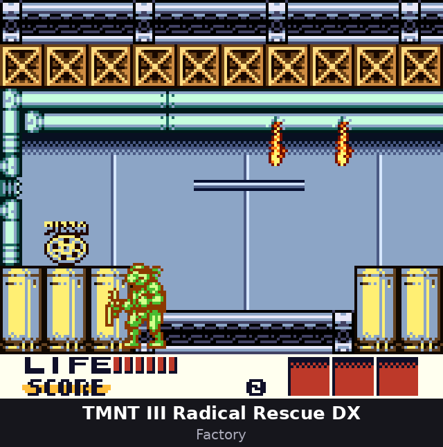
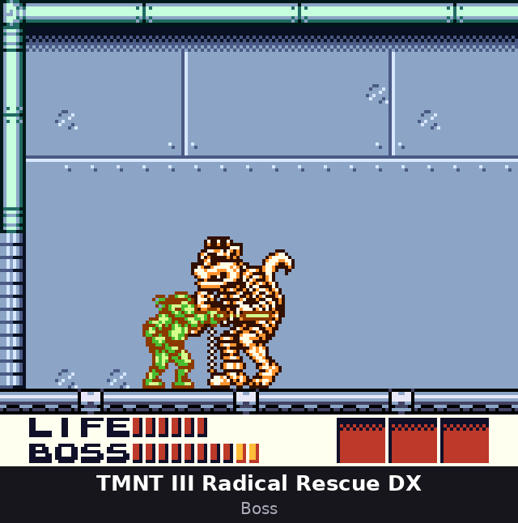

### Mighty Morphin Power Rangers

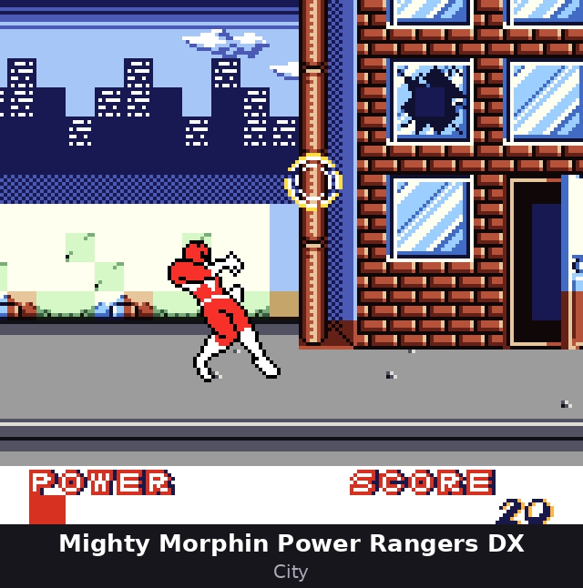
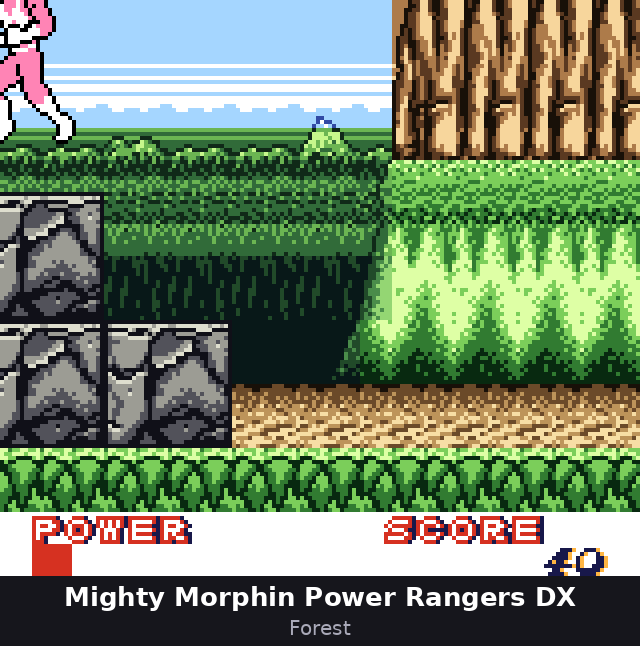
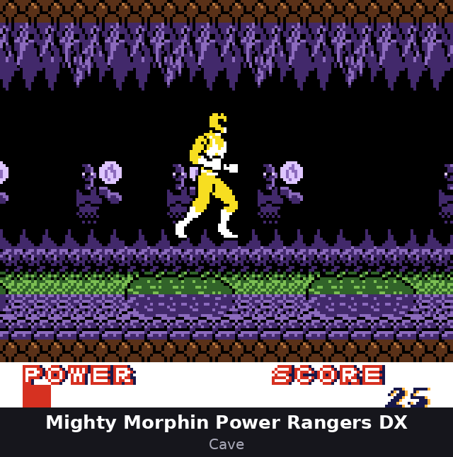
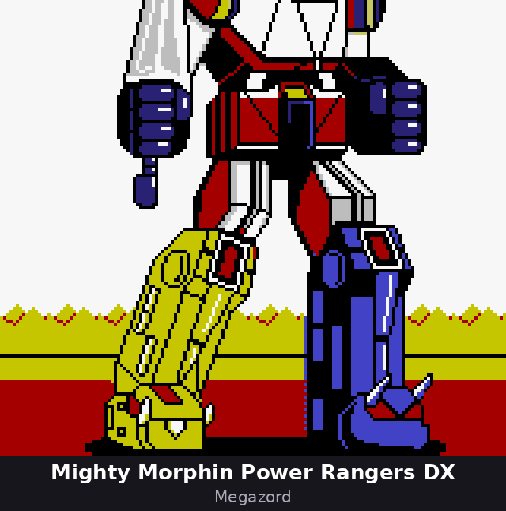
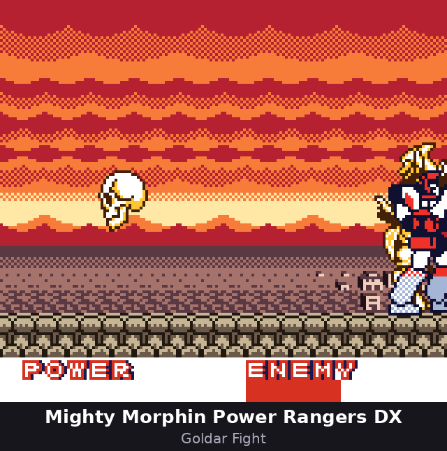

## How to play

1. Open the IPS patch for your game and use GitHub’s **Download raw file** button.
2. In an IPS patcher, select the patch and a clean, compatible ROM dump from your own cartridge. Keep a copy of your original dump.
3. Open the patched ROM in an emulator set to Game Boy Color mode, or play it on compatible hardware.
